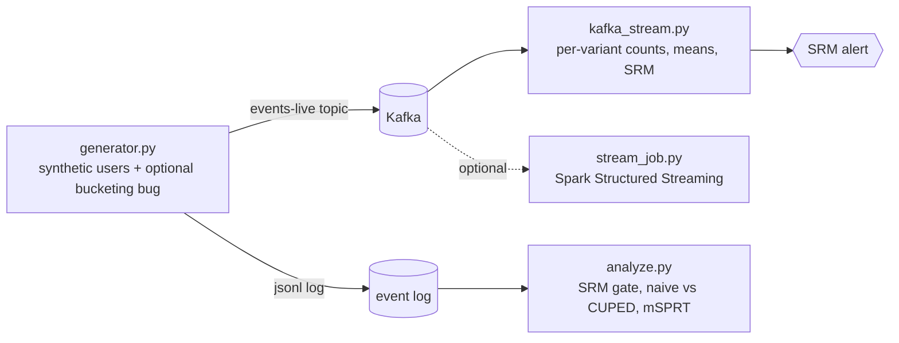

# Streaming experiment monitoring: live SRM alerts, CUPED, and sequential testing

A small, runnable demo of how an experimentation platform can watch an A/B test as events arrive. A generator publishes synthetic assignment and engagement events to Kafka. A consumer aggregates them by variant and raises a sample-ratio-mismatch (SRM) alert when the observed split drifts from the intended 50/50. A separate offline analysis applies CUPED variance reduction and an always-valid sequential test (mSPRT).

**Status:** demo on synthetic data, not a production system. See "Limitations".

## Why SRM comes first

A statistically significant lift is not trustworthy if users were not assigned as designed. In the demo run, a bucketing bug starts after user 3,000 and over-assigns treatment. The offline CUPED p-value on the full run is tiny (5.6e-12), but the experiment is invalid, and the SRM check says so first.

## Architecture



| Path | Status |
|---|---|
| Kafka consumer (`src/kafka_stream.py`) | Primary live demo. Run end to end on Windows with Docker Desktop. |
| Offline analysis (`src/analyze.py`) | Run on the generated event log. Results below. |
| Spark job (`src/stream_job.py`) | Optional. Not verified on native Windows (Hadoop `winutils` version mismatch). No results from this path are reported here. |

## Run it (Windows PowerShell, from the repo root)

Requirements: Docker Desktop, Python 3.10+.

```powershell
python -m venv .venv
.\.venv\Scripts\Activate.ps1
pip install -r requirements.txt

docker compose up -d
docker exec exp-kafka /opt/kafka/bin/kafka-topics.sh --bootstrap-server localhost:9092 --create --topic events-live --partitions 1 --replication-factor 1

# terminal 1: live consumer (stops after 15 seconds without messages)
python src/kafka_stream.py

# terminal 2: 6000 users at 500/s, bucketing bug after user 3000
python src/generator.py --users 6000 --rate 500 --bug-after 3000 --out data/events-live.jsonl

# offline readout on the same events
python src/analyze.py --events data/events-live.jsonl
python src/analyze.py --events data/events-live.jsonl --max-users 3000   # pre-bug users only

python -m pytest -q
```

The generator uses a fixed seed, so runs produce the same users and the numbers below should reproduce.

## Live consumer output

Replaying the event log through the same aggregation code the consumer uses (every 500 users):

```text
users=1000  control=498   treatment=502   SRM_p=0.899    status=OK
users=3000  control=1528  treatment=1472  SRM_p=0.307    status=OK
users=4000  control=1919  treatment=2081  SRM_p=0.0104   status=OK
users=4500  control=2118  treatment=2382  SRM_p=8.3e-05   status=ALERT: SRM detected
users=6000  control=2709  treatment=3291  SRM_p=5.75e-14  status=ALERT: SRM detected
```

The alert fires about 1,500 users after the bug starts. The check uses cumulative counts with a strict threshold (alpha 0.001), so clean early data dilutes the skew and detection lags. A windowed check would react faster.

## Offline results

6,000 users, true lift +0.6, bug after user 3,000.

| View | Result |
|---|---|
| Full run | SRM p = 5.75e-14: ALERT. Estimates are not trustworthy. |
| First 3,000 users (pre-bug), naive | diff +0.444, CI (-0.043, +0.932), p = 0.074. Misses the real effect. |
| First 3,000 users, CUPED | diff +0.573, CI (+0.307, +0.840), p = 2.6e-05. 70% variance reduction. Detects it. |

Always-valid p-values (mSPRT, running minimum), rows before the bug:

| Users | Naive | CUPED |
|---|---|---|
| 1,000 | 1.000 | 0.035 |
| 1,500 | 1.000 | 0.004 |
| 3,000 | 1.000 | 0.001 |

## Design notes

- **SRM:** chi-square test against the intended split, alpha 0.001 because it is evaluated repeatedly. No verdict below 500 users.
- **CUPED:** pre-experiment engagement as the covariate, theta pooled across arms. The covariate is fixed before assignment, so treatment cannot affect it.
- **mSPRT:** normal mixture prior on the effect. The running minimum of 1/LR is an always-valid p-value, so continuous monitoring does not inflate false positives. A test simulates 300 null experiments with a look every 100 users and checks the false positive rate stays under 8%. The prior sd is set as a share of the metric sd for simplicity; in practice, fix it from historical effect sizes before launch.
- **Tests:** 13 pytest tests cover the statistics, the generator's fault injection, window-state replay, and the live aggregator. Kafka itself is not mocked or tested.

## Limitations

- **Consumer state:** cumulative and in memory. No windows, no watermark, no persistence, so a restart replays from the earliest offset.
- **Exactly-once and duplicates:** not handled. The consumer does not dedupe by event id. The generator uses an idempotent producer, and `analyze.py` dedupes by event id.
- **Late and out-of-order data:** the generator emits some late events, but only the optional Spark job has a watermark. The consumer counts every event.
- **Backfills:** replay by starting a new consumer group from the earliest offset, or re-run `analyze.py` on the event log. No orchestration.
- **Outcome lag:** engagement is emitted with the assignment. Real metrics arrive later and need attribution windows.
- **Scale:** single broker, single partition, single machine, synthetic data. No throughput claims.
- **Causal validity:** randomization is simulated. Interference and novelty effects are not modeled.

## Optional: Spark Structured Streaming job

`src/stream_job.py` computes per-minute, per-variant aggregates with a watermark and runs the same SRM check in `foreachBatch`. Install `requirements-spark.txt`, then:

```bash
spark-submit --packages org.apache.spark:spark-sql-kafka-0-10_2.12:3.5.1 src/stream_job.py
```

Not verified on native Windows.
