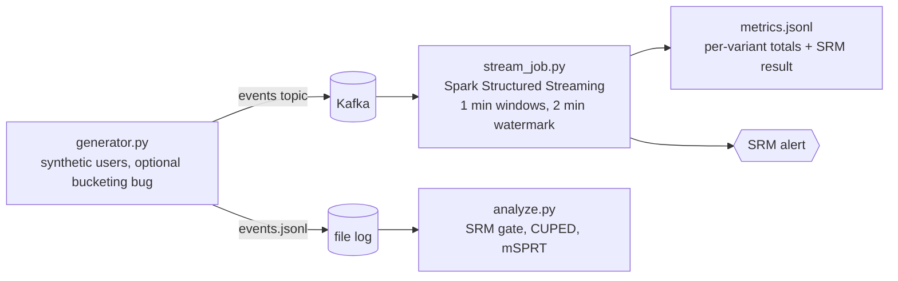

# Streaming experiment metrics with SRM alerts, CUPED, and sequential testing

A small, runnable demo of an A/B measurement stack: events flow through Kafka into Spark Structured Streaming, which computes live per-variant metrics and raises sample-ratio-mismatch (SRM) alerts. An offline readout then applies CUPED variance reduction and an always-valid sequential test (mSPRT).

Status: a demo on synthetic data, not a production system. See "What this does not handle".

## Architecture



## Run it

Requirements: Docker, Python 3.10+, Java 17 (for Spark).

```bash
pip install -r requirements.txt
docker compose up -d                      # single-node Kafka on localhost:9092

# terminal 1: stream job (downloads the Spark Kafka connector on first run)
spark-submit --packages org.apache.spark:spark-sql-kafka-0-10_2.12:3.5.1 src/stream_job.py

# terminal 2: 6000 users at 200/s, with a bucketing bug after user 3000
python src/generator.py --users 6000 --rate 200 --bug-after 3000

# offline readout
python src/analyze.py                     # full run: SRM alert fires
python src/analyze.py --max-users 3000    # pre-bug data only
python -m pytest -q                       # statistics and state logic
rm -rf /tmp/exp-checkpoint data/metrics.jsonl   # before re-running the stream job
```

## What the demo shows

Offline run on the included generator (6000 users, true lift +0.6, bug after user 3000):

| View | Result |
|---|---|
| Full run | SRM p = 6e-14: alert, effect estimates not trustworthy |
| First 3000 users, naive | diff +0.44, CI (-0.04, +0.93), p = 0.07: misses the real effect |
| First 3000 users, CUPED | diff +0.57, CI (+0.31, +0.84), 70% variance reduction: detects it |
| Sequential (CUPED) | always-valid p below 0.05 by about 1000 users, below 0.005 by 1500 |

## Design notes

- **SRM**: chi-square against the intended 50/50 split on cumulative per-variant user counts, alpha 0.001 because it is evaluated on every micro-batch.
- **CUPED**: pre-experiment engagement as the covariate, theta pooled across arms. The covariate is fixed before assignment, so it cannot be affected by treatment.
- **mSPRT**: normal mixture prior on the effect, running minimum of 1/LR gives an always-valid p-value, so continuous peeking does not inflate false positives. A test simulates 300 null experiments with a look every 100 users and checks the false positive rate stays under 8%. The prior sd is set as a share of the metric sd for simplicity; in practice, fix it from historical effect sizes before launch.
- **Late data**: 2% of events arrive 90 seconds late (inside the watermark and counted), and 0.5% arrive 5 minutes late (past the watermark and dropped from streaming windows). So the streaming totals undercount the file log by about 0.5% by design. The offline readout is the source of truth.
- **State**: Spark runs in update mode, which re-emits the full value of each touched window. The driver keeps a map keyed by (window, variant) and overwrites, so replaying a batch does not double count.

## What this does not handle

- **Exactly-once**: Kafka source plus `foreachBatch` is at-least-once. The overwrite-by-key pattern makes the metrics sink idempotent, but the driver-side state is in memory and is lost on restart. Production would write window rows to a table and compute SRM from it.
- **Duplicates**: prevented at the producer (idempotent producer). The stream job does not dedupe by event id, because chaining dedup before a windowed aggregation is unsupported in update mode. The offline analysis dedupes by event id.
- **Backfills**: replay by pointing a fresh checkpoint at earliest offsets, or re-run `analyze.py` on the event log. No automated backfill orchestration.
- **Outcome lag**: engagement is emitted at the same time as assignment. Real metrics arrive later and need attribution windows.
- **Scale**: single broker, single machine, synthetic data. No claims about throughput.
- **Causal validity**: randomization is simulated. Interference and novelty effects are not modeled.
